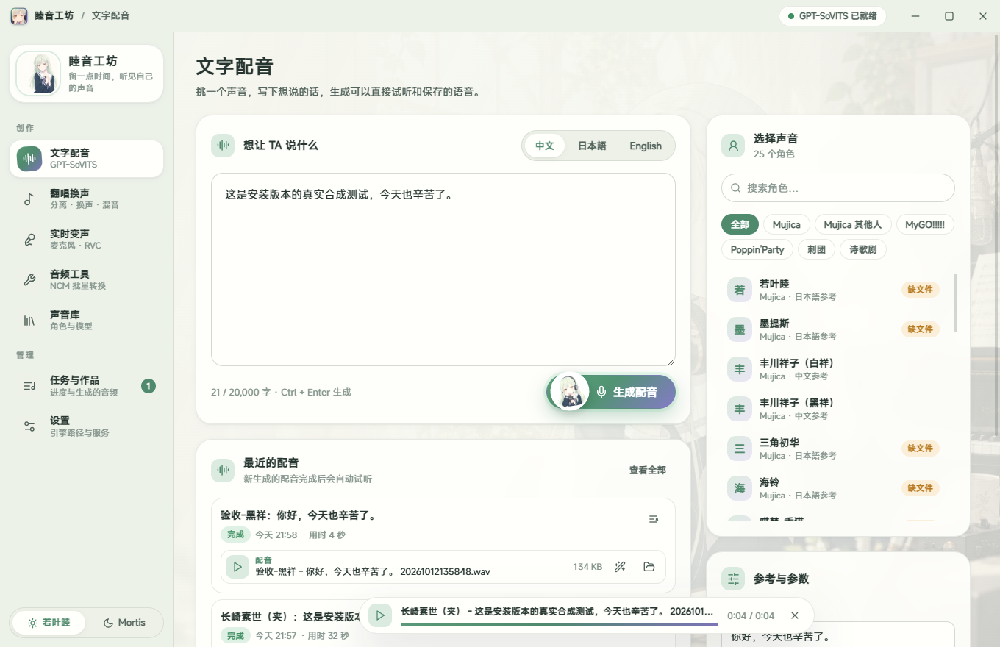
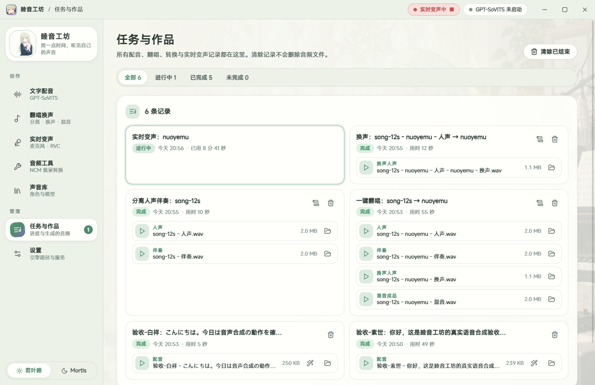

# 睦音工坊 Mutsumi Audio Studio

Windows 本地音频工作台：把 GPT-SoVITS、RVC/UVR、FFmpeg 与本机音频设备串成一条可用的工作流，覆盖**文字配音**、**翻唱与音频处理**、**实时变声**三大场景。

模型与上游 Python 环境由使用者自行准备 —— **本程序不下载模型，也不提供模型训练**。





## 功能

### 文字配音（GPT-SoVITS）

- 选择角色 → 输入文本 → 生成 WAV，支持中文 / 日本語 / English 三种合成语言
- 角色管理：GPT 与 SoVITS 权重、参考音频、参考文本分开配置，可搜索、分组、编辑
- 完整的 TTS 切分选项（`cut0`–`cut5`）与语速、采样步数、片段间隔参数
- 生成结果落盘记录、自动试听、另存导出

### 翻唱与音频处理（RVC + UVR + FFmpeg）

- 五种动作：一键翻唱混音、单独分离人声、单独分离伴奏、独立换声、独立混音
- 全参数可调：说话人 ID、变调、F0 算法、索引比例、滤波半径、重采样率、音量包络、无声保护、UVR 聚合度、输出格式与音量
- WAV / FLAC / MP3 导出；人声、伴奏、换声结果与混音成品都能继续作为下一步输入
- 阶段进度、日志、队列、取消与错误重试

### 实时变声（RVC）

- 麦克风输入 → 模型推理 → 耳机监听或虚拟声卡输出
- WASAPI / DirectSound / MME / WDM-KS 设备枚举，设备不兼容时可切换端点
- 显式启停、模型与设备状态、遥测、可选录制、设备失败恢复

### 音频工具

- 批量解密转换本机 NCM 文件，逐项汇报成功与失败

### 统一任务队列

- 配音 / 翻唱 / NCM 统一排队，GPU 任务串行调度，避免争抢显存
- 持久化任务记录与作品库；清除记录不会删除音频文件

## 技术栈

| 层 | 说明 |
| --- | --- |
| 桌面框架 | Electron 35 |
| 界面 | React 19 + TypeScript 5.8 |
| 构建 | electron-vite 3 / Vite 6；electron-builder 26 打包 NSIS 安装包与便携 ZIP |
| 主进程 | `app/` 窗口托盘与 IPC、`core/` 状态与子进程、`services/` 任务队列与推理编排 |
| 推理 | 以子进程方式调用使用者自备的 GPT-SoVITS API 与 RVC Python 环境 |

## 项目结构

```
shared/            主进程与界面共享的数据契约与 IPC 通道定义
electron/
├── app/           窗口、托盘、IPC 注册、studio-media:// 本地音频协议
├── core/          状态存储与 2.x 数据迁移、设置规范化、输入校验、子进程工具
├── services/      任务队列、GPT-SoVITS 托管与合成、RVC 扫描、NCM 解密、实时变声
└── workers/       Python worker（RVC 离线任务、实时变声）
src/
├── ui/            基础组件
├── shell/         外壳
├── pages/         七个页面
├── state/         全局状态与试听播放器
├── assets/themes/ 两套主题素材
└── styles/        主题令牌与样式
```

所有偏好、声音档案与任务历史保存在 `%APPDATA%\smartchat\mutsumi-audio-studio\studio-state-v3.json`；首次运行会从 2.x 的 `studio-state.json` 与界面 localStorage 迁移，旧文件不改动。开发测试可用环境变量 `MUTSUMI_USER_DATA` 指定独立数据目录。

## 首次设置

1. 打开「设置」，分别选择 GPT-SoVITS 与 RVC 的项目目录和 Python 解释器（RVC 解释器需已装好对应模型的推理依赖）
2. GPT-SoVITS 可连接本机 v2 API；勾选「应用启动时管理 GPT-SoVITS 服务」后，程序会用已设置的目录与解释器尝试启动服务，设置页可检查接口状态
3. 在「声音库」扫描 RVC 模型与索引；在文字配音页维护角色使用的 GPT / SoVITS 模型、参考音频与参考文本
4. 设置常用输出目录

## 实时变声依赖

实时工作台复用现有 RVC 环境，另需 `sounddevice`（Windows wheel 内含 PortAudio）。设置页提示依赖缺失时可执行：

```powershell
& "<你的 RVC 环境>\Scripts\python.exe" -m pip install -r "<安装目录>\resources\workers\requirements-realtime.txt"
```

音频设备扫描只读取设备清单，不采集麦克风；实际采集仅在用户显式启动实时变声期间进行。麦克风监听建议使用耳机以避免扬声器回授。推理速度、可用设备与实际延迟取决于本机模型、音频驱动与硬件。

## 开发与打包

```powershell
npm install
npm run dev        # 开发模式
npm run typecheck  # 类型检查
npm run release    # 生成图标 → 类型检查 → 清理构建 → 打包 NSIS 与便携 ZIP
```

发布脚本会把安装包与 ZIP 输出到独立的版本目录并写入 SHA256SUMS，目录已存在时拒绝覆盖。应用图标由 `node resources/make-icon.js` 从唯一主图生成，打包后由 `scripts/after-pack-icon.cjs` 写入 EXE 图标与版本信息。打包版不包含 GPT-SoVITS / RVC 模型与 Python 虚拟环境。

## 说明

- 本仓库**不包含**任何模型权重、参考音频或 Python 虚拟环境，需自行准备
- **不内置角色档案**：全新数据目录下首次运行时声音库为空，请在界面里自行添加；升级安装可能迁移已有档案。仓库不含任何作者本机的路径
- 使用他人训练的模型、音色或音频素材前，请自行确认授权与适用法律；本项目只提供工作流工具
- 截图用于展示界面布局，其中的角色档案与任务记录均为使用者自行添加的示例

## 素材与许可

- **代码**部分以 [MIT](LICENSE) 授权
- **界面主题素材**（`src/assets/themes/` 下的立绘、贴纸、背景，`resources/` 下的图标源图，以及 `docs/images/` 截图）是在第三方作品角色的二次创作范围内制作的同人素材，**不在 MIT 授权范围内**
- 这些素材仅随本仓库用于个人、非营利用途；如需商用、再分发或用于其他作品，请自行确认并遵守原作品方的要求

## License

[MIT](LICENSE)
